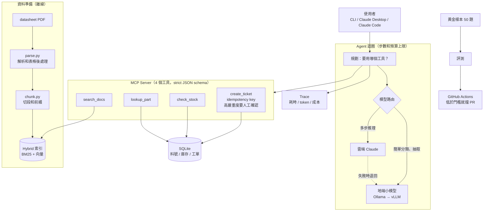

# 料號助手 Part Assistant

工廠知識問答和工單 Agent：用 **RAG、Tool Use 和 MCP**，回答伺服器電源的規格問題、查料號和庫存，並且開立工單。

> **專案性質**：這是一個學習用的作品集 side project，**不是正式上線的系統**。
> - 知識庫是各電源廠商**公開下載**的 datasheet。
> - 料號、庫存、工單都是**自己產生的假資料**。
> - 不含任何公司的內部資料。測出來的效能數字都會註明硬體環境。

---

## 目錄

- [它能做什麼](#它能做什麼)
- [架構](#架構)
- [目前進度](#目前進度)
- [快速開始](#快速開始)
- [專案結構](#專案結構)
- [資料](#資料)
- [評測：黃金樣本](#評測黃金樣本)
- [設計決策](#設計決策)
- [已知限制](#已知限制)
- [授權](#授權)

---

## 它能做什麼

使用者可以用中文或英文問問題，agent 會自己判斷要**查文件**、**查資料庫**，還是**開工單**：

| 使用者問 | Agent 怎麼做 | 回答 |
|---|---|---|
| TEC3200 在 50% 負載時的效率是多少？ | 搜尋 datasheet | 96%（出處：`bel-tec3200-54.pdf` 第 2 頁） |
| PSU-1600-54V 還有多少可用庫存？ | 呼叫 `check_stock` | 513 顆（3 個倉庫加總） |
| 料號 PSU-3200-54V 滿載時的 hold-up time？ | `lookup_part` 查出原廠型號，再用 `search_docs` 查規格書 | 9 ms |
| TEC3200 的保固是幾年？ | 搜尋後找不到 | **「文件中沒有寫」**，不會拿其他廠商的保固來回答 |
| 1600W 電源的待機輸出是多少？ | 發現有 4 個型號符合 | **反問是哪一個型號** |
| PSU-3200-54V 冒煙，開一張高嚴重度工單 | 準備 `create_ticket` | **先請人工確認**，確認後才開單 |

### 設計原則

1. **找不到就說不知道**：在工廠裡，答錯的規格比不回答危險得多。
2. **每個答案都附出處**：檔名加頁碼，讓人可以回去查證。
3. **精確的數字查資料庫，不靠模型猜**：庫存一定要呼叫工具查詢，不從文件或模型的記憶裡生出來。
4. **用黃金樣本決定能不能上線**：分數低於門檻，CI 就擋下 PR。

---

## 架構



### 各元件說明

| 元件 | 做什麼 | 為什麼這樣設計 |
|---|---|---|
| **資料準備** | PDF → 文字和表格區塊 → chunk → 索引 | 規格書的答案大多在表格裡，表格處理決定了 RAG 的品質 |
| **Hybrid 檢索** | BM25（關鍵字）加向量（語意） | 料號要**精確比對**（`TEC1600` 和 `TEC3200` 只差一個字），語意問題則要靠向量 |
| **4 個工具** | 查文件、查料號、查庫存、開工單 | 用 strict JSON schema 限制模型只能傳合法的參數 |
| **MCP Server** | 把工具包成標準協定 | 同一組工具可以接到 Claude Desktop、Claude Code，或我們自己的 agent |
| **模型路由** | 依任務難度選模型 | 簡單的工作交給地端小模型，省成本；困難的交給雲端模型，顧品質；雲端失敗時退回地端 |
| **Trace** | 記錄每次模型和工具呼叫 | 能回答「這題為什麼答錯」和「每題花多少錢」 |
| **推論閘道**（第二階段） | OpenAI 相容的 gateway | 速率限制、token 配額、PII 遮罩、監控，所有模型呼叫都經過它 |

---

## 目前進度

**第一階段：料號助手**

- ✅ 專案骨架（uv、pytest、ruff）
- ✅ SQLite 假資料：料號、庫存、工單（`idempotency_key` 有 UNIQUE 約束）
- ✅ 9 份公開 datasheet 下載，附 SHA-256 驗證
- ✅ PDF 解析和表格後處理（合併儲存格、註腳、跨頁表格）
- ✅ 黃金樣本 50 題，加上驗證測試
- ✅ 切段（chunk），加上解析快取
- ⬜ Hybrid 檢索（BM25 + 多語向量）
- ⬜ 4 個工具和 agent 迴圈
- ⬜ 評測程式，跑出第一個分數
- ⬜ MCP server
- ⬜ `create_ticket` 的冪等和逾時重試測試
- ⬜ GitHub Actions：每個 PR 都跑評測，低於門檻就失敗
- ⬜ Trace、步數和預算上限
- ⬜ 模型路由（Ollama ↔ Claude）
- ⬜ Docker Compose 一鍵啟動

**縮小和實際上線的差距**（成本低，但都是企業 AI 系統的必要能力）

- ⬜ **文件版本**：chunk 記錄 `revision` 和生效日期，預設只檢索現行版；黃金樣本加「新舊版數值不同」的題目
- ⬜ **權限過濾**：每份文件有 `access_level`，在**檢索層**依使用者角色過濾，不靠模型「不要說出來」
- ⬜ **間接 prompt injection**：在一份假文件裡藏惡意指令，驗證 agent 不會照著執行
- ⬜ **稽核紀錄**：trace 附上使用者 ID，記錄誰問了什麼、呼叫了哪些工具、改了什麼資料
- ⬜ **斷路器和降級**：模型服務故障時，庫存查詢等純資料庫功能照常運作

**第二階段：推論閘道**

- ⬜ vLLM 跑 1.5B–3B 的小模型；比較 FP16 和 INT4（AWQ / GPTQ）的記憶體、TTFT、tokens/s 和黃金樣本分數
- ⬜ 每個使用者的速率限制和 token 配額、輸入端 PII 遮罩、輸出端 schema 驗證
- ⬜ Prometheus 指標加 Grafana 面板
- ⬜ 壓測，換算每千次請求的成本
- ⬜（選做）Kubernetes manifest 範例

**第三階段（選做）**：SECOM 半導體良率預測

---

## 快速開始

> 目前完成的是資料準備和評測資料。下面只列出**現在就能跑**的指令，其他功能完成後再補上。

需要：Python 3.12、[uv](https://docs.astral.sh/uv/)

```bash
git clone https://github.com/DongYuYu/part-assistant.git
cd part-assistant

uv sync                                   # 安裝套件（版本鎖定在 uv.lock）
uv run python -m part_assistant.download  # 下載 9 份 datasheet 到 data/raw/，並驗證 SHA-256
uv run python -m part_assistant.seed      # 產生 SQLite 假資料到 data/processed/factory.db
uv run python -m part_assistant.chunk     # 解析 PDF 並切段 → data/processed/chunks.jsonl（第一次約 2 分鐘）
uv run pytest -q                          # 跑全部測試
```

> 用到真實 PDF 的測試，第一次會比較慢（版面分析模型跑在 CPU 上）。沒有下載 PDF 時，這些測試會自動跳過。

---

## 專案結構

```
part-assistant/
├── src/part_assistant/
│   ├── db.py          # SQLite 資料表和連線
│   ├── seed.py        # 產生假資料（每次結果都一樣）
│   ├── download.py    # 照清單下載 datasheet，驗證 SHA-256
│   ├── parse.py       # PDF → 文字和表格區塊，加上後處理和快取
│   ├── chunk.py       # 區塊 → 檢索用的 chunk（附檔名、頁碼、章節）
│   └── golden.py      # 讀取黃金樣本、比對答案
├── data/
│   ├── sources.toml   # datasheet 清單：網址和 SHA-256（PDF 本身不進 git）
│   ├── raw/           # 下載的 PDF（被 gitignore）
│   └── processed/     # SQLite、解析結果（被 gitignore，可以重新產生）
├── design/          # 各元件的設計說明（例如 chunking.md）
├── eval/
│   └── golden.toml    # 黃金樣本 50 題
└── tests/             # pytest
```

---

## 資料

### 知識庫：9 份公開 datasheet，3 家廠商

| 廠商 | 型號 | 功率 | 輸出 | 特色 |
|---|---|---|---|---|
| Advanced Energy | CSU1600AT | 1600 W | 12 V | 67 頁技術手冊 |
| Advanced Energy | CSU2400AT | 2400 W | 12 V | M-CRPS，表格有註腳 |
| Bel Power Solutions | TEC1600 | 1600 W | 12 V | 有跨 3 頁的表格 |
| Bel Power Solutions | PES1600 | 1600 W | 12 V | 唯一的 Platinum 等級 |
| Bel Power Solutions | TEC3200-54 | 3200 W | 54 V | 無格線表格，合併儲存格 |
| Mornsun | LMS800-P12B | 800 W | 12 V | |
| Mornsun | LMS1600-P12B | 1600 W | 12 V | 和 LMS2000 用同一個範本 |
| Mornsun | LMS2000-P12B | 2000 W | 12 V | |
| Mornsun | LMS2700-T12B | 2700 W | 12 V | |

刻意挑了**容易搞混**的組合：4 個 1600W 型號、同一家廠商的相似型號、用同一個範本的文件。用來測試檢索會不會張冠李戴。

**為什麼 PDF 不放進 git？** datasheet 的版權屬於各廠商，「可以公開下載」不等於「可以再散布」。repo 裡只放清單（`data/sources.toml`），由下載腳本向原廠抓取。清單記錄了每份文件的 **SHA-256**：原廠如果更新了文件，下載會直接失敗，不會讓評測答案在沒人發現的情況下改變。

### 假資料：SQLite

| 資料表 | 內容 |
|---|---|
| `parts` | 18 個料號（電源、風扇、連接器、電容），其中 3 個對應到上面的 datasheet |
| `inventory` | 每個料號 × 3 個倉庫的在庫數和預留數 |
| `tickets` | 工單；`idempotency_key` 有 UNIQUE 約束 |

料號刻意取得很像（`PSU-1600-12V` 和 `PSU-1600-54V`），也刻意讓某些料號完全沒有庫存，方便出評測題。

---

## 評測：黃金樣本

`eval/golden.toml` 有 **50 題人工查證過答案的題目**。每一題的答案都回到 PDF 原頁查證過，困難的表格還看過頁面截圖。

| 分類 | 題數 | 測什麼 |
|---|---|---|
| spec | 12 | 一般規格查詢 |
| table | 8 | 困難表格（合併儲存格、一格多值、條件不同數值也不同） |
| footnote | 4 | 註腳有沒有跟著表格 |
| similar | 4 | 會不會把相似型號的數值搞混 |
| tool | 6 | 會不會呼叫正確的工具和參數 |
| multi | 4 | 多步驟：料號 → 原廠型號 → 規格書 |
| refuse | 6 | **資料裡沒有時，會不會老實說不知道** |
| clarify | 3 | 問題不明確時，會不會反問 |
| ticket | 3 | 開單流程、人工確認、不存在的料號 |

一題長這樣：

```toml
[[case]]
id = "table-02"
category = "table"
question = "TEC3200 在 10% 負載時的效率是多少？"
expect = "answer"
must_include = ["90"]
must_not_include = ["15%"]      # 15% 是同一張表上 iTHD 的數值
sources = [{ file = "bel-tec3200-54.pdf", page = 2 }]
why = "First row of a centered merged cell; forward-fill would label it iTHD (15%)."
```

- **`why` 是必填欄位**：每一題都要說明它在測什麼。
- **`known_issue` 標記目前已知會失敗的題目**：不為了分數好看就刪題。修好之後分數上升，就是修正有效的證據。
- **黃金樣本本身也有測試**（`tests/test_golden.py`）：檢查 id 有沒有重複、檔名和頁碼是否存在、料號是否存在。黃金樣本出錯，分數就沒有意義。

---

## 設計決策

### PDF 解析：表格是重點

規格書的答案大多在表格裡，但 PDF 裡**沒有「表格」這種結構**，只有「在座標 (x, y) 畫出這段文字」。我們遇到並解決了這些問題：

| 問題 | 例子 | 解法 |
|---|---|---|
| 合併儲存格 | 一格 `Efficiency` 橫跨 4 列 | 有格線的表格：展開 HTML 的 `rowspan` |
| 無格線表格的合併儲存格 | 參數名稱垂直置中，落在群組的**中間列**；單純向下補滿，會把第一列標成上一組的名稱 | 讀取 PDF 的**底色和格線**，以視覺邊界分組 |
| 註腳記號 | `0 A¹` 被讀成 `0 A 1`，看起來像一個數值 | 以「字體小於 75% 而且基線較高」判斷，改寫成 `0 A[^1]` |
| 重複的頁首 | 每頁頂端都有型號標題 | 出現在 ≥ 25% 頁面上的短行就移除 |
| 跨頁表格 | 第 14 頁的表格沒有表頭 | 欄數相同就接到前一頁的表格，沿用表頭 |

所有規則都對應到**真實文件中的案例**，並且有測試鎖住（`tests/test_parse.py`）。

### 切段：讓每個 chunk 單獨被檢索到時也看得懂

> 完整說明（含例子、取捨和可能的追問）見 [design/chunking.md](design/chunking.md)。

| 規則 | 為什麼 |
|---|---|
| 表格不從列中間切開；大表依列切開，**每一段都重複表頭** | 只有 `\| 94 \| % \|` 沒有表頭，就不知道是哪個負載下的效率 |
| 表格後面的**註腳說明複製進表格的 chunk** | 只檢索到 `0 A[^1]`，模型看不到「最小負載 5%」的條件 |
| colspan 展開的重複儲存格合併成一個 | 同一個值重複 6 次會浪費 token，也會干擾 embedding |
| 文字遇到標題就切開；約 400 tokens，下一段重複前一段結尾約 15% | 邊界上的句子不會被切成兩半；overlap 不跨章節 |
| 每個 chunk 開頭加上 `[廠商 \| 型號 \| 檔名 \| 頁碼 \| 章節]` | 內文常寫 "the power supply" 而不寫型號；加上前綴，BM25 才能用型號找到它，回答也能附出處 |
| `chunk_id` = 內容的雜湊值 | 內容不變，ID 就不變，之後 embedding 只需處理有變動的 chunk |
| 先預留 `revision`、`access_level` 欄位 | 之後做版本和權限過濾時，不必整份重建索引 |

**用黃金樣本檢查上限**：`tests/test_chunk.py` 會檢查每一題的答案確實出現在「來源頁的 chunk」裡。如果 chunk 裡沒有答案，後面的檢索再怎麼優化也找不到。目前 40 題通過，2 題是已知的解析問題（標記 xfail）。

**快取**：解析結果以「PDF 的 SHA-256 + `PARSER_VERSION`」當 key 存起來。修改解析程式時要把版本號加一，否則會拿到舊程式產生的過期結果。第一次約 2 分鐘，之後約 0.3 秒。

### 為什麼選 pymupdf4llm？

我們用同一張困難表格比較過 `pdfplumber` 和 `pymupdf4llm`。pdfplumber 靠表格的**格線**找表格，所以**漏掉了整張無格線的表格**。pymupdf4llm 有版面分析模型，而且能輸出帶 `rowspan` 的 HTML。

⚠️ 代價是 pymupdf 系列採用 **AGPL-3.0** 授權（見[授權](#授權)）。

### 其他決定

- **設定檔用 TOML**：Python 3.11 以上內建 `tomllib`，不必多裝一個 YAML 套件。依賴越少，供應鏈風險越小。
- **假資料可以重現**：固定亂數種子和時間戳，每次產生的資料都完全相同，評測答案才不會飄移。
- **下載時先寫暫存檔再改名**：程式中途當掉，也不會留下寫到一半的 PDF。
- **檢查檔案開頭是 `%PDF-`**：有些網站擋爬蟲時會回傳 HTTP 200 加上一個 HTML 頁面，只看狀態碼會被騙。

---

## 已知限制

誠實列出目前做不到的事：

- **不支援掃描檔**：所有 datasheet 都有文字層。掃描檔需要 OCR，OCR 在規格書上很容易認錯（例如 `0` 和 `O`、`µ` 和 `p`）。
- **約 50 張表格的參數名稱是「推測」的**：找不到視覺邊界時退回向下補滿，並標記 `labels_inferred`。
- **LMS2700-T12B 的效率表解析錯誤**：10% 和 20% 兩列遺失，Input Current 被誤標成 Efficiency。黃金樣本 `table-05` 和 `table-06` 用來追蹤這個問題。
- **電路圖可能被誤判成表格**（例如 PES1600 第 8 頁）。
- **第一次解析很慢**：9 份文件約 2 分鐘，因為版面分析模型跑在 CPU 上。之後會使用快取（約 0.3 秒）。
- **token 數是估計值**：目前以「4 個字元約等於 1 個 token」估算，確切數字要等選定 embedding 模型後再用它的 tokenizer 計算。
- **跨頁的大表被切開後，每一段都標示整張表的頁碼範圍**（例如 `p.12-14`），因為合併時沒有保留每一列的頁碼。
- **問題是中文、文件是英文**：BM25 無法用「效率」比對到 "Efficiency"，所以向量檢索要用多語 embedding 模型。

---

## 授權

- 本專案用到 [PyMuPDF](https://github.com/pymupdf/PyMuPDF) 和 pymupdf4llm，它們採用 **AGPL-3.0** 授權。如果用這份程式碼對外提供網路服務，必須依 AGPL 公開原始碼。若要在不能公開原始碼的環境使用，需要購買 PyMuPDF 的商業授權，或把解析器換成 MIT 授權的替代方案（例如 Docling）。
- datasheet 的版權屬於各原廠，本 repo 不散布 PDF，只提供下載清單。
