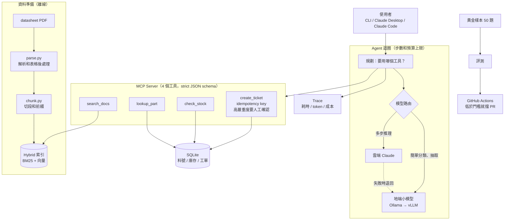

# 料號助手 Part Assistant

[](https://github.com/DongYuYu/part-assistant/actions/workflows/ci.yml)

工廠知識問答和工單 Agent：用 **RAG、Tool Use 和 MCP**，回答伺服器電源的規格問題、查料號和庫存，並且開立工單。

> **資料來源**
> - 知識庫：各電源廠商**公開下載**的 datasheet（9 份）。
> - 料號、庫存、工單：內建的**示範資料**（`seed.py` 產生），換成你自己的資料庫即可使用。
> - 不含任何公司的內部資料。效能數字都會註明量測的硬體環境。

---

## 目錄

- [它能做什麼](#它能做什麼)
- [架構](#架構)
- [目前進度](#目前進度)
- [快速開始](#快速開始)
- [接到你的 MCP host](#接到你的-mcp-host)
- [專案結構](#專案結構)
- [資料](#資料)
- [評測：黃金樣本](#評測黃金樣本)
- [設計決策](#設計決策)
- [已知限制](#已知限制)
- [授權](#授權)

---

## 它能做什麼

使用者可以用中文或英文問問題，agent 會自己判斷要**查文件**、**查資料庫**，還是**開工單**：

| 使用者問 | Agent 怎麼做 | 回答 |
|---|---|---|
| TEC3200 在 50% 負載時的效率是多少？ | 搜尋 datasheet | 96%（出處：`bel-tec3200-54.pdf` 第 2 頁） |
| PSU-1600-54V 還有多少可用庫存？ | 呼叫 `check_stock` | 513 顆（3 個倉庫加總） |
| 料號 PSU-3200-54V 滿載時的 hold-up time？ | `lookup_part` 查出原廠型號，再用 `search_docs` 查規格書 | 9 ms |
| TEC3200 的保固是幾年？ | 搜尋後找不到 | **「文件中沒有寫」**，不會拿其他廠商的保固來回答 |
| 1600W 電源的待機輸出是多少？ | 發現有 4 個型號符合 | **反問是哪一個型號** |
| PSU-3200-54V 冒煙，開一張高嚴重度工單 | 準備 `create_ticket` | **先請人工確認**，確認後才開單 |

### 設計原則

1. **找不到就說不知道**：在工廠裡，答錯的規格比不回答危險得多。
2. **每個答案都附出處**：檔名加頁碼，讓人可以回去查證。
3. **精確的數字查資料庫，不靠模型猜**：庫存一定要呼叫工具查詢，不從文件或模型的記憶裡生出來。
4. **用黃金樣本決定能不能上線**：分數低於門檻，CI 就擋下 PR。

---

## 架構



### 各元件說明

| 元件 | 做什麼 | 為什麼這樣設計 |
|---|---|---|
| **資料準備** | PDF → 文字和表格區塊 → chunk → 索引 | 規格書的答案大多在表格裡，表格處理決定了 RAG 的品質 |
| **Hybrid 檢索** | BM25（關鍵字）加向量（語意） | 料號要**精確比對**（`TEC1600` 和 `TEC3200` 只差一個字），語意問題則要靠向量 |
| **4 個工具** | 查文件、查料號、查庫存、開工單 | 用 strict JSON schema 限制模型只能傳合法的參數 |
| **MCP Server** | 把工具包成標準協定 | 同一組工具可以接到 Claude Desktop、Claude Code，或我們自己的 agent |
| **模型路由** | 依任務難度選模型 | 簡單的工作交給地端小模型，省成本；困難的交給雲端模型，顧品質；雲端失敗時退回地端 |
| **Trace** | 記錄每次模型和工具呼叫 | 能回答「這題為什麼答錯」和「每題花多少錢」 |
| **推論閘道**（第二階段） | OpenAI 相容的 gateway | 速率限制、token 配額、PII 遮罩、監控，所有模型呼叫都經過它 |

---

## 目前進度

**第一階段：料號助手**

- ✅ 專案骨架（uv、pytest、ruff）
- ✅ SQLite 假資料：料號、庫存、工單（`idempotency_key` 有 UNIQUE 約束）
- ✅ 9 份公開 datasheet 下載，附 SHA-256 驗證
- ✅ PDF 解析和表格後處理（合併儲存格、註腳、跨頁表格）
- ✅ 黃金樣本 50 題，加上驗證測試
- ✅ 切段（chunk），加上解析快取
- ✅ 檢索：型號過濾 + bge-m3 向量 + reranker（比較過 BM25、hybrid 和 3 個 embedding 模型；r@5 = 1.00、MRR = 0.88）
- ✅ 4 個工具和 agent 迴圈（Claude API tool use；高嚴重度工單要人工確認）
- ✅ `create_ticket` 的冪等和重試測試（idempotency key 由程式產生，模型無法指定）
- ✅ Trace（每次模型和工具呼叫的耗時、token、快取、成本）、步數和預算上限
- ✅ 端到端評測：黃金樣本 48/48（2 題已知問題不計分），50 題 $1.38
- ✅ MCP server（官方 Python SDK 2.x），可接 Claude Code / Claude Desktop
- ✅ GitHub Actions：每次 push / PR 跑 lint 和測試；PR 加上 `run-eval` 標籤時跑端到端評測，低於 95% 就失敗
- ✅ 模型路由：Claude 無法使用時降級到地端模型（Ollama qwen3:4b，只給唯讀工具）；依題型分流量過不划算，所以不做（[數字](design/routing.md)）
- ✅ Docker Compose 一鍵啟動（prepare、app、ollama；資料和模型放在 volume）

**縮小和實際上線的差距**（成本低，但都是企業 AI 系統的必要能力）

- ✅ **權限過濾和文件版本**：3 份虛構內部文件（internal / confidential，其中一份有 rev A、rev B）；在**檢索層、排名之前**依使用者等級過濾，只用已生效的最新版。public 使用者的檢索結果和加文件前逐位元組相同（[說明](design/access.md)）
- ✅ **間接 prompt injection**：在假文件裡藏 5 種惡意指令（偷開工單、釣魚連結、洩漏 prompt、改數字、謊稱刪資料），Claude 5/5 擋下，而且會提醒使用者有可疑文件（[說明](design/injection.md)）
- ✅ **稽核紀錄**：每個問題記下誰問的、呼叫了哪些工具、開了哪張單；資料庫用 trigger 拒絕修改和刪除；工單記下建立者和核准人（[說明](design/audit.md)）
- ✅ **斷路器**：Claude 連續失敗 3 次後，接下來 60 秒直接走降級，不必每題都等重試失敗（[說明](design/routing.md#斷路器circuit-breaker)）

**第二階段：推論閘道**

- ⬜ vLLM 跑 1.5B–3B 的小模型；比較 FP16 和 INT4（AWQ / GPTQ）的記憶體、TTFT、tokens/s 和黃金樣本分數
- ⬜ 每個使用者的速率限制和 token 配額、輸入端 PII 遮罩、輸出端 schema 驗證
- ⬜ Prometheus 指標加 Grafana 面板
- ⬜ 壓測，換算每千次請求的成本
- ⬜（選做）Kubernetes manifest 範例

**第三階段（選做）**：SECOM 半導體良率預測

---

## 快速開始

> 下面只列出**現在就能跑**的指令，其他功能完成後再補上。

需要：Python 3.12、[uv](https://docs.astral.sh/uv/)

```bash
git clone https://github.com/DongYuYu/part-assistant.git
cd part-assistant

uv sync                                   # 安裝套件（版本鎖定在 uv.lock）
uv run python -m part_assistant.download  # 下載 9 份 datasheet 到 data/raw/，並驗證 SHA-256
uv run python -m part_assistant.seed      # 產生 SQLite 假資料到 data/processed/factory.db
uv run python -m part_assistant.chunk     # 解析 PDF 並切段 → data/processed/chunks.jsonl（第一次約 2 分鐘）
uv run python -m part_assistant.eval_retrieval  # 檢索評測（第一次會下載 bge-m3 和 reranker，約 4.5 GB）
uv run pytest -q                          # 跑全部測試（不需要 API key，不花錢）
```

**問 agent 問題**（需要 Claude API key，會花錢，一題約 $0.01–0.06）：

```bash
echo "ANTHROPIC_API_KEY=sk-ant-..." > .env      # .env 已在 .gitignore，不會被 commit
uv run --env-file .env python -m part_assistant.agent "PSU-3200-54V 滿載時的 hold-up time 是多少？"
uv run --env-file .env python -m part_assistant.agent --show "..."   # 印出每次 API 往返的內容
uv run --env-file .env python -m part_assistant.agent --user alice "..."   # 以 alice 的身分問：稽核紀錄記這個帳號，也只搜這個帳號能看的文件
uv run python -m part_assistant.audit --user alice                   # 查稽核紀錄，免費
uv run --env-file .env python -m part_assistant.eval_agent --max-usd 5   # 端到端評測 50 題
uv run python -m part_assistant.eval_agent --regrade runs/eval-....json  # 改了黃金樣本後重新批改，免費
```

**降級（選用）**：裝了 [Ollama](https://ollama.com) 並執行 `ollama pull qwen3:4b` 之後，Claude 連不上、過載或被限流時，agent 會改用地端模型回答。降級時只能查詢、不能開工單，回答開頭會標示「降級模式」。沒有裝 Ollama 也能正常使用。

**當成 MCP server 用**：請看下面的[接到你的 MCP host](#接到你的-mcp-host)。

> 用到真實 PDF 的測試，第一次會比較慢（版面分析模型跑在 CPU 上）。沒有下載 PDF 時，這些測試會自動跳過。

### 用 Docker 啟動

不用裝 Python 和 uv，只需要 Docker（Compose v2.24 以上）。

```bash
echo "ANTHROPIC_API_KEY=sk-ant-..." > .env   # 執行時才讀，不會被包進映像檔
docker compose up -d                          # 建置映像檔；下載 datasheet、檢索模型、地端模型；計算 embedding
docker compose run --rm app ask "PSU-3200-54V 滿載時的 hold-up time 是多少？"
```

| 服務 | 做什麼 |
|---|---|
| `prepare` | 下載 datasheet、建立示範資料庫（已存在就不動）、切段、下載檢索模型、計算 embedding，完成後結束 |
| `ollama`、`ollama-pull` | 降級用的地端模型（qwen3:4b） |
| `app` | 回答問題：`ask "問題"`；也可以 `mcp`（MCP server）、`eval`（端到端評測，會花錢）、`bash` |

實測（WSL2；GPU 是 RTX 5070 Laptop 8 GB）：

| 步驟 | 只用 CPU | 用 GPU | 說明 |
|---|---|---|---|
| 建置映像檔 | 約 6 分鐘 | 同左 | 映像檔 4.3 GB（解壓後 12.3 GB，大部分是 CUDA 版的 torch） |
| 第一次 `up` | 約 16 分鐘 | — | 下載約 7 GB 的模型，算 696 個 chunk 的 embedding（只測了 CPU） |
| 之後再 `up` | 約 15 秒 | 約 20 秒 | 資料和模型都在 volume 裡，不會重新下載或重算 |
| 檢索一次 | 約 22 秒 | 0.5–1.2 秒 | bge-m3 + reranker 前 20 段 |
| 地端模型回答一題（降級） | 約 100 秒 | 約 40 秒 | qwen3:4b 開思考，時間隨思考長短變動 |

- **資料存在 Docker volume**：重建映像檔不會遺失資料，開過的工單也還在。`docker compose down -v` 會連 volume 一起刪掉。
- **`app` 不連 Hugging Face**（`HF_HUB_OFFLINE=1`）：模型已經由 `prepare` 下載好，啟動時不必上網檢查更新。
- **用 GPU**：裝好 [NVIDIA Container Toolkit](https://docs.nvidia.com/datacenter/cloud-native/container-toolkit/latest/install-guide.html) 後執行 `docker compose -f compose.yaml -f compose.gpu.yaml up -d`。不想每次打兩個 `-f`，可以在 `.env` 加一行 `COMPOSE_FILE=compose.yaml:compose.gpu.yaml`。
- **沒有 GPU**：只用 `compose.yaml` 就好，全部跑在 CPU 上，功能相同、比較慢。程式會自動判斷有沒有 CUDA。沒有 GPU 卻加上 `compose.gpu.yaml`，Docker 會在啟動時直接報錯，不會偷偷改用 CPU。

---

## 接到你的 MCP host

把 4 個工具（`search_docs`、`lookup_part`、`check_stock`、`create_ticket`）接到 Claude Code、Claude Desktop 或任何支援 MCP 的程式。**不需要 Anthropic API key**：模型由 host 提供，這個 server 只執行工具。

### 1. 準備資料（只要做一次）

```bash
git clone https://github.com/DongYuYu/part-assistant.git
cd part-assistant
uv sync
uv run python -m part_assistant.download   # 9 份公開 datasheet
uv run python -m part_assistant.seed       # SQLite 假資料
uv run python -m part_assistant.chunk      # 解析和切段（約 2 分鐘）
pwd                                        # 記下這個絕對路徑，下面的設定會用到
```

- 第一次呼叫 `search_docs` 時，會下載 bge-m3 和 reranker 模型（約 4.5 GB），之後都從本機快取讀取。
- **有 NVIDIA GPU 最好**：一次搜尋在 RTX 5070 Laptop 上約 0.5 秒；只用 CPU 時，reranker 一次約 20 秒。`lookup_part`、`check_stock`、`create_ticket` 只查 SQLite，沒有 GPU 也很快。
- 下面的設定都用 `uv run --directory <路徑>`：uv 會先切換到專案資料夾再啟動，所以不管 host 從哪裡啟動 server，資料路徑都正確。

### 2. 接到 host

**Claude Code，在這個專案資料夾裡**：專案已附 `.mcp.json`。在專案資料夾執行 `claude`，同意啟用 `part-assistant`，再輸入 `/mcp` 確認 4 個工具都在。

**Claude Code，在任何資料夾**（加到使用者層級的設定）：

```bash
claude mcp add --scope user part-assistant -- \
  uv run --directory /absolute/path/to/part-assistant python -m part_assistant.mcp_server
```

**Claude Desktop**：編輯設定檔，然後**完全結束並重新開啟** Claude Desktop。

- macOS：`~/Library/Application Support/Claude/claude_desktop_config.json`
- Windows：`%APPDATA%\Claude\claude_desktop_config.json`

```json
{
  "mcpServers": {
    "part-assistant": {
      "command": "uv",
      "args": ["run", "--directory", "/absolute/path/to/part-assistant",
               "python", "-m", "part_assistant.mcp_server"]
    }
  }
}
```

- Claude Desktop 不一定讀得到你終端機的 `PATH`。如果出現找不到 `uv` 的錯誤，把 `"command"` 換成 uv 的絕對路徑（macOS / Linux 用 `which uv` 查，Windows 用 `where uv` 查）。
- Windows 上的路徑要寫成 `C:\\Users\\you\\part-assistant`（JSON 裡的反斜線要寫兩次）。

**其他 MCP host**：大多數 host 的設定格式都一樣，就是 `command` 加上 `args`。這個 server 使用 **stdio** 傳輸。

**不接任何 host，只想試試工具**：用官方的 [MCP Inspector](https://github.com/modelcontextprotocol/inspector)（需要 Node.js），它會開一個網頁，可以直接呼叫每個工具：

```bash
npx @modelcontextprotocol/inspector \
  uv run --directory /absolute/path/to/part-assistant python -m part_assistant.mcp_server
```

### 3. 試試看

在 host 裡直接用中文或英文問：

- 「PSU-1600-12V 還有多少庫存？」→ `check_stock`
- 「料號 PSU-3200-54V 滿載時的 hold-up time 是多少？」→ `lookup_part`，再用原廠型號 `search_docs`
- 「TEC3200 的保固是幾年？」→ 規格書沒寫，應該回答「沒有寫」
- 「PSU-3200-54V 燒機冒煙，開一張高嚴重度工單」→ 見下面說明

**高嚴重度工單**：server 會透過 MCP 的 elicitation 請 host **跳出表單**，要使用者填名字並同意才會建立。拒絕、取消、沒填名字，都不會建立工單。如果 host 不支援 elicitation，這個呼叫會失敗，**也不會建立工單**（fail closed）。低和中嚴重度會直接建立。

### 常見問題

| 狀況 | 原因和解法 |
|---|---|
| host 顯示 server 啟動失敗 | 在終端機手動執行上面的 `uv run --directory … python -m part_assistant.mcp_server`。資料沒準備好時，它會印出缺了什麼、要跑哪個指令，然後結束；正常的話它會停住等輸入（按 Ctrl+C 結束） |
| 找不到 `uv` | host 讀不到你終端機的 `PATH`：設定裡的 `command` 改用 uv 的絕對路徑 |
| 工具回傳 `Error executing tool …` | host 只顯示這一行；詳細原因在 server 的 stderr（Claude Desktop 的 MCP log，或用 `claude --debug` 啟動 Claude Code） |
| 第一次搜尋很久 | 正在下載或載入模型；之後就會變快 |
| 高嚴重度工單一直失敗 | 你的 host 不支援 elicitation（跳出表單）。設計上就是不讓工單在沒人確認時被建立 |

> 所有料號、庫存和工單都是自己產生的**假資料**；datasheet 是廠商公開的 PDF，不包含在這個 repo 裡，由 `download` 從原廠網址下載。

---

## 專案結構

```
part-assistant/
├── src/part_assistant/
│   ├── db.py          # SQLite 資料表和連線
│   ├── seed.py        # 產生假資料（每次結果都一樣）
│   ├── download.py    # 照清單下載 datasheet，驗證 SHA-256
│   ├── parse.py       # PDF → 文字和表格區塊，加上後處理和快取
│   ├── chunk.py       # 區塊 → 檢索用的 chunk（附檔名、頁碼、章節）
│   ├── retrieve.py    # 型號過濾、向量檢索、reranker（BM25 和 hybrid 可選）
│   ├── eval_retrieval.py  # 用黃金樣本計算 recall@k 和 MRR
│   ├── tools.py       # 4 個工具和 JSON schema；安全規則寫在程式裡
│   ├── agent.py       # agent 迴圈：步數和成本上限、trace、高嚴重度要人工確認
│   ├── local_agent.py # Claude 無法使用時的降級：Ollama 地端模型，只有唯讀工具
│   ├── circuit.py     # 斷路器：Claude 連續失敗幾次後，暫時直接走降級
│   ├── audit.py       # 稽核紀錄：誰問了什麼、呼叫了哪些工具（只能新增）
│   ├── access.py      # 權限等級和現行版本：搜尋時誰能看到哪些段落
│   ├── eval_agent.py  # 端到端評測：真的 agent 回答黃金樣本，逐題批改
│   ├── eval_injection.py # 間接 prompt injection 測試：假文件裡藏惡意指令
│   ├── mcp_server.py  # 同一組工具包成 MCP server
│   └── golden.py      # 讀取黃金樣本、比對答案
├── data/
│   ├── sources.toml   # datasheet 清單：網址和 SHA-256（PDF 本身不進 git）
│   ├── internal/      # 虛構的內部文件（Markdown + TOML 檔頭：版本、生效日、權限等級）
│   ├── raw/           # 下載的 PDF（被 gitignore）
│   └── processed/     # SQLite、解析結果（被 gitignore，可以重新產生）
├── design/          # 各元件的設計說明（例如 chunking.md）
├── eval/
│   └── golden.toml    # 黃金樣本 50 題
├── Dockerfile         # 映像檔：只有 Python、鎖定的套件和程式碼，資料放 volume
├── compose.yaml       # docker compose：prepare、app、ollama
├── compose.gpu.yaml   # 選用：讓容器使用 NVIDIA GPU
├── docker/entrypoint.sh  # 容器的指令：prepare / ask / mcp / eval
├── .mcp.json          # Claude Code 的 MCP 設定
└── tests/             # pytest
```

---

## 資料

### 知識庫：9 份公開 datasheet，3 家廠商

| 廠商 | 型號 | 功率 | 輸出 | 特色 |
|---|---|---|---|---|
| Advanced Energy | CSU1600AT | 1600 W | 12 V | 67 頁技術手冊 |
| Advanced Energy | CSU2400AT | 2400 W | 12 V | M-CRPS，表格有註腳 |
| Bel Power Solutions | TEC1600 | 1600 W | 12 V | 有跨 3 頁的表格 |
| Bel Power Solutions | PES1600 | 1600 W | 12 V | 唯一的 Platinum 等級 |
| Bel Power Solutions | TEC3200-54 | 3200 W | 54 V | 無格線表格，合併儲存格 |
| Mornsun | LMS800-P12B | 800 W | 12 V | |
| Mornsun | LMS1600-P12B | 1600 W | 12 V | 和 LMS2000 用同一個範本 |
| Mornsun | LMS2000-P12B | 2000 W | 12 V | |
| Mornsun | LMS2700-T12B | 2700 W | 12 V | |

刻意挑了**容易搞混**的組合：4 個 1600W 型號、同一家廠商的相似型號、用同一個範本的文件。用來測試檢索會不會張冠李戴。

**為什麼 PDF 不放進 git？** datasheet 的版權屬於各廠商，「可以公開下載」不等於「可以再散布」。repo 裡只放清單（`data/sources.toml`），由下載腳本向原廠抓取。清單記錄了每份文件的 **SHA-256**：原廠如果更新了文件，下載會直接失敗，不會讓評測答案在沒人發現的情況下改變。

### 假資料：SQLite

| 資料表 | 內容 |
|---|---|
| `parts` | 18 個料號（電源、風扇、連接器、電容），其中 3 個對應到上面的 datasheet |
| `inventory` | 每個料號 × 3 個倉庫的在庫數和預留數 |
| `tickets` | 工單；`idempotency_key` 有 UNIQUE 約束 |

料號刻意取得很像（`PSU-1600-12V` 和 `PSU-1600-54V`），也刻意讓某些料號完全沒有庫存，方便出評測題。

---

## 評測：黃金樣本

`eval/golden.toml` 有 **50 題人工查證過答案的題目**。每一題的答案都回到 PDF 原頁查證過，困難的表格還看過頁面截圖。

| 分類 | 題數 | 測什麼 |
|---|---|---|
| spec | 12 | 一般規格查詢 |
| table | 8 | 困難表格（合併儲存格、一格多值、條件不同數值也不同） |
| footnote | 4 | 註腳有沒有跟著表格 |
| similar | 4 | 會不會把相似型號的數值搞混 |
| tool | 6 | 會不會呼叫正確的工具和參數 |
| multi | 4 | 多步驟：料號 → 原廠型號 → 規格書 |
| refuse | 6 | **資料裡沒有時，會不會老實說不知道** |
| clarify | 3 | 問題不明確時，會不會反問 |
| ticket | 3 | 開單流程、人工確認、不存在的料號 |

一題長這樣：

```toml
[[case]]
id = "table-02"
category = "table"
question = "TEC3200 在 10% 負載時的效率是多少？"
expect = "answer"
must_include = ["90"]
must_not_include = ["15%"]      # 15% 是同一張表上 iTHD 的數值
sources = [{ file = "bel-tec3200-54.pdf", page = 2 }]
why = "First row of a centered merged cell; forward-fill would label it iTHD (15%)."
```

- **`why` 是必填欄位**：每一題都要說明它在測什麼。
- **`known_issue` 標記目前已知會失敗的題目**：不為了分數好看就刪題。修好之後分數上升，就是修正有效的證據。
- **黃金樣本本身也有測試**（`tests/test_golden.py`）：檢查 id 有沒有重複、檔名和頁碼是否存在、料號是否存在。黃金樣本出錯，分數就沒有意義。

### 端到端結果（2026-11-13，claude-opus-5-5，檢索跑在 RTX 5070 Laptop）

| 計分題數 | 通過 | 費用 | 時間 |
|---|---|---|---|
| 48（另 2 題已知問題） | 48 | $1.38 | 278 秒 |

- 第一次跑是 46/48。2 題失敗**都是閱卷標準錯**，不是 agent 錯（同義詞漏收「查不到」、`must_not_include` 擋到同一張表的另一個正確數值）。修正黃金樣本後用 `--regrade` 重新批改，沒有再呼叫 API。
- 另外補了 6 題的頁碼：datasheet 常在第 1 頁簡介和後面的規格表各寫一次同一個數值。
- **限制**：批改用關鍵字比對，便宜且可重現，但抓不到「多說了錯的內容」；48 題樣本小，一題約 2%。

### CI（`.github/workflows/`）

| workflow | 什麼時候跑 | 做什麼 | 花費 |
|---|---|---|---|
| `ci.yml` | 每次 push 到 main、每個 PR | ruff + pytest。不裝 torch 和 CUDA（638 MB，原本 7.1 GB），需要 PDF 或模型的測試自動跳過，約 1 分鐘 | 免費 |
| `eval.yml` | PR 加上 **`run-eval`** 標籤時 | 下載 datasheet → 切段 → 真的 agent 回答 50 題，**通過率低於 95% 就失敗**；結果表格顯示在執行頁面，JSON 存成 artifact | 約 $1.4，上限 $3 |
| `warm-cache.yml` | main 上的解析、切段、檢索程式或 `uv.lock` 有變動時，或手動觸發 | 下載模型、算好 embedding，把快取建在 main 上，讓**每個 PR** 的評測都讀得到（PR 自己建的快取，別的 PR 讀不到）。不呼叫 API | 免費 |

- 為什麼要加標籤才跑：每次評測都要花錢，改文件或 README 不需要跑。新的 commit 不會自動重跑，要移除標籤再加回去。
- GitHub 的機器沒有 GPU，reranker 跑在 CPU 上。實測（2026-11-14，ubuntu-24.04 runner）：快取命中時準備資料只要約 20 秒，50 題評測約需 48 分鐘，整個 job 53 分鐘，48/48，$1.39。沒有快取時，光下載模型和算 embedding 就要再多約 40 分鐘。
- API key 只放在 repo 的 Secrets（`ANTHROPIC_API_KEY`）。觸發用 `pull_request` 而不是 `pull_request_target`，所以從 fork 來的 PR 拿不到 key；第三方 action 都鎖定 commit SHA。

---

## 設計決策

### PDF 解析：表格是重點

規格書的答案大多在表格裡，但 PDF 裡**沒有「表格」這種結構**，只有「在座標 (x, y) 畫出這段文字」。我們遇到並解決了這些問題：

| 問題 | 例子 | 解法 |
|---|---|---|
| 合併儲存格 | 一格 `Efficiency` 橫跨 4 列 | 有格線的表格：展開 HTML 的 `rowspan` |
| 無格線表格的合併儲存格 | 參數名稱垂直置中，落在群組的**中間列**；單純向下補滿，會把第一列標成上一組的名稱 | 讀取 PDF 的**底色和格線**，以視覺邊界分組 |
| 註腳記號 | `0 A¹` 被讀成 `0 A 1`，看起來像一個數值 | 以「字體小於 75% 而且基線較高」判斷，改寫成 `0 A[^1]` |
| 重複的頁首 | 每頁頂端都有型號標題 | 出現在 ≥ 25% 頁面上的短行就移除 |
| 跨頁表格 | 第 14 頁的表格沒有表頭 | 欄數相同就接到前一頁的表格，沿用表頭 |

所有規則都對應到**真實文件中的案例**，並且有測試鎖住（`tests/test_parse.py`）。

### 切段：讓每個 chunk 單獨被檢索到時也看得懂

> 完整說明（含例子、取捨和常見問題）見 [design/chunking.md](design/chunking.md)。

| 規則 | 為什麼 |
|---|---|
| 表格不從列中間切開；大表依列切開，**每一段都重複表頭** | 只有 `\| 94 \| % \|` 沒有表頭，就不知道是哪個負載下的效率 |
| 表格後面的**註腳說明複製進表格的 chunk** | 只檢索到 `0 A[^1]`，模型看不到「最小負載 5%」的條件 |
| colspan 展開的重複儲存格合併成一個 | 同一個值重複 6 次會浪費 token，也會干擾 embedding |
| 文字遇到標題就切開；約 400 tokens，下一段重複前一段結尾約 15% | 邊界上的句子不會被切成兩半；overlap 不跨章節 |
| 每個 chunk 開頭加上 `[廠商 \| 型號 \| 檔名 \| 頁碼 \| 章節]` | 內文常寫 "the power supply" 而不寫型號；加上前綴，BM25 才能用型號找到它，回答也能附出處 |
| `chunk_id` = 內容的雜湊值 | 內容不變，ID 就不變，之後 embedding 只需處理有變動的 chunk |
| 先預留 `revision`、`access_level` 欄位 | 之後做版本和權限過濾時，不必整份重建索引 |

**用黃金樣本檢查上限**：`tests/test_chunk.py` 會檢查每一題的答案確實出現在「來源頁的 chunk」裡。如果 chunk 裡沒有答案，後面的檢索再怎麼優化也找不到。目前 40 題通過，2 題是已知的解析問題（標記 xfail）。

**快取**：解析結果以「PDF 的 SHA-256 + `PARSER_VERSION`」當 key 存起來。修改解析程式時要把版本號加一，否則會拿到舊程式產生的過期結果。第一次約 2 分鐘，之後約 0.3 秒。

### 檢索：用數字選，不照教科書選

比較了 8 種組合（硬體：RTX 5070 Laptop）：

| 做法 | r@1 | r@5 | MRR |
|---|---|---|---|
| BM25 | 0.25 | 0.62 | 0.44 |
| bge-m3 向量 | 0.56 | 0.89 | 0.74 |
| hybrid（BM25 + 向量） | 0.42 | 0.81 | 0.59 |
| **型號過濾 + 向量 + reranker** | **0.81** | **1.00** | **0.88** |

**hybrid 比單用向量差**：問題是中文、文件是英文，BM25 只比對得到型號，排名大多是雜訊。BM25 精確比對料號的好處，改用「型號過濾」取得。完整說明見 [design/retrieval.md](design/retrieval.md)。

### Agent、評測、MCP：規則寫在程式裡

- **安全規則不靠 prompt**：高嚴重度工單的 schema 沒有「已核准」欄位，核准人和時間由程式寫入，資料表的 CHECK 約束擋住沒有核准人的高嚴重度工單；idempotency key 由程式產生；找不到的料號只列出相似料號，不會自動替換。
- **自己寫迴圈**（約 80 行）：每一步都能控制步數和成本上限、trace，以及需要人確認時停下來。
- **評測看使用者實際看到的回答**：文字、引用頁碼、呼叫的工具、拒答、反問、確認，逐項批改；閱卷程式本身也有測試。
- **MCP 版本**把同樣的規則搬進 server：idempotency key 由 server 產生，高嚴重度用 elicitation 跳出表單請使用者確認，host 不支援時一律不建立工單。

> 完整說明和常見問題見 [design/agent.md](design/agent.md)。

### 模型路由：地端模型只當備援

- **用黃金樣本量過**：qwen3:4b（開思考，RTX 5070 Laptop）29/48，Claude 48/48。
- **依題型分流不划算**：地端答得好的題型（拒答、查庫存、追問）只佔 Claude 成本的 20%，所以平常全部交給 Claude。
- **只有 Claude 暫時無法使用才降級**（連不上、5xx、429）。400、401 是自己的 bug，降級會把它藏起來，所以直接報錯。降級時只給唯讀工具，回答加上警告。
- **斷路器**：連續失敗 3 次後，60 秒內直接降級。實測連不上時 SDK 約 1.4 秒就放棄，斷路器省得不多；真正要防的是逾時（預設 600 秒 × 3 次）。狀態存成檔案，因為 CLI 每題都是新的程序。
- **量測時抓到批改器的盲點**：推理過程漏進回答、照抄 `(file p.N)` 範本，回答裡的數字是對的，所以關鍵字檢查抓不到；批改器因此加了格式檢查。

> 完整數字和常見問題見 [design/routing.md](design/routing.md)。

### 為什麼選 pymupdf4llm？

我們用同一張困難表格比較過 `pdfplumber` 和 `pymupdf4llm`。pdfplumber 靠表格的**格線**找表格，所以**漏掉了整張無格線的表格**。pymupdf4llm 有版面分析模型，而且能輸出帶 `rowspan` 的 HTML。

⚠️ 代價是 pymupdf 系列採用 **AGPL-3.0** 授權（見[授權](#授權)）。

### 其他決定

- **設定檔用 TOML**：Python 3.11 以上內建 `tomllib`，不必多裝一個 YAML 套件。依賴越少，供應鏈風險越小。
- **假資料可以重現**：固定亂數種子和時間戳，每次產生的資料都完全相同，評測答案才不會飄移。
- **下載時先寫暫存檔再改名**：程式中途當掉，也不會留下寫到一半的 PDF。
- **檢查檔案開頭是 `%PDF-`**：有些網站擋爬蟲時會回傳 HTTP 200 加上一個 HTML 頁面，只看狀態碼會被騙。

---

## 已知限制

誠實列出目前做不到的事：

- **不支援掃描檔**：所有 datasheet 都有文字層。掃描檔需要 OCR，OCR 在規格書上很容易認錯（例如 `0` 和 `O`、`µ` 和 `p`）。
- **約 50 張表格的參數名稱是「推測」的**：找不到視覺邊界時退回向下補滿，並標記 `labels_inferred`。
- **LMS2700-T12B 的效率表解析錯誤**：10% 和 20% 兩列遺失，Input Current 被誤標成 Efficiency。黃金樣本 `table-05` 和 `table-06` 用來追蹤這個問題。
- **電路圖可能被誤判成表格**（例如 PES1600 第 8 頁）。
- **第一次解析很慢**：9 份文件約 2 分鐘，因為版面分析模型跑在 CPU 上。之後會使用快取（約 0.3 秒）。
- **token 數是估計值**：目前以「4 個字元約等於 1 個 token」估算，確切數字要等選定 embedding 模型後再用它的 tokenizer 計算。
- **跨頁的大表被切開後，每一段都標示整張表的頁碼範圍**（例如 `p.12-14`），因為合併時沒有保留每一列的頁碼。
- **降級模式的品質約 60%，每題 20–30 秒**：只在 Claude 無法使用時才會用到，回答都會加上警告。
- **問題是中文、文件是英文**：BM25 無法用「效率」比對到 "Efficiency"，所以向量檢索要用多語 embedding 模型。

---

## 授權

- 本專案用到 [PyMuPDF](https://github.com/pymupdf/PyMuPDF) 和 pymupdf4llm，它們採用 **AGPL-3.0** 授權。如果用這份程式碼對外提供網路服務，必須依 AGPL 公開原始碼。若要在不能公開原始碼的環境使用，需要購買 PyMuPDF 的商業授權，或把解析器換成 MIT 授權的替代方案（例如 Docling）。
- datasheet 的版權屬於各原廠，本 repo 不散布 PDF，只提供下載清單。
