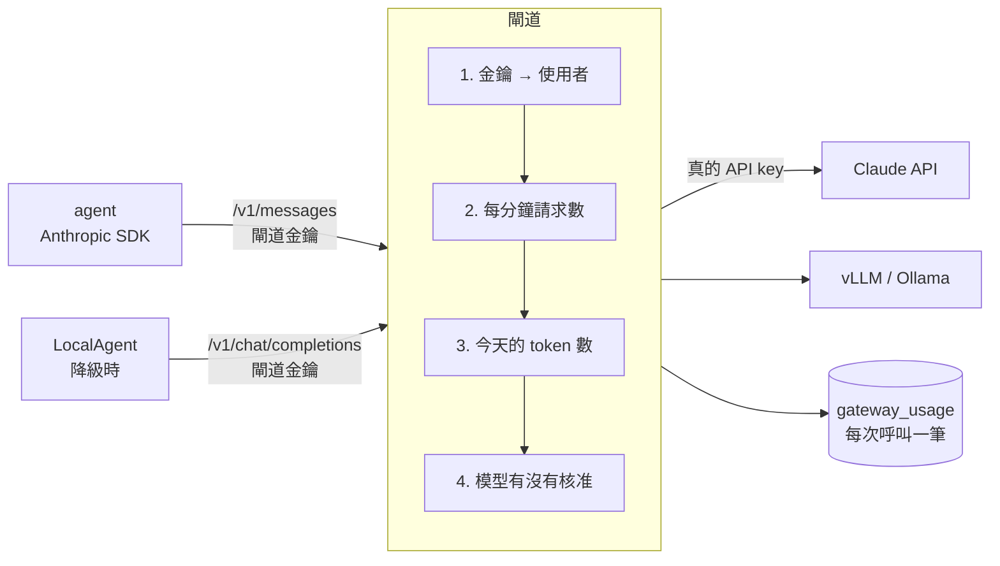

# 推論閘道（gateway）

一句話：**app 的所有模型呼叫都先經過閘道。閘道確認是誰在用、有沒有超過額度，再轉給對應的模型，並記下用了多少 token、花了多少錢。**
閘道不決定要用哪個模型（那是 agent 的事，見 [routing.md](routing.md)），也不轉換格式。

程式：`src/part_assistant/gateway.py`。測試：`tests/test_gateway.py`（假的上游，不連網路、不花錢）。

## 目錄

- [一、為什麼要有閘道](#一為什麼要有閘道)
- [二、怎麼運作](#二怎麼運作)
- [三、怎麼用](#三怎麼用)
- [四、設計取捨](#四設計取捨)
- [五、實測](#五實測)
- [六、限制和下一步](#六限制和下一步)
- [七、常見問題（Q&A）](#七常見問題qa)

## 一、為什麼要有閘道

沒有閘道時，每個 app 都自己拿著真的 API key 直接呼叫 Claude：

| 問題 | 沒有閘道 | 有閘道 |
|---|---|---|
| 金鑰 | 每個 app、每台電腦都有真的 key；外洩要全部換 | 真的 key 只在閘道；每個人有自己的閘道金鑰，可以單獨停用 |
| 誰用了多少 | 只看得到整個帳號的帳單 | 每次呼叫一筆：誰、哪個模型、多少 token、多少錢 |
| 失控 | 一個寫壞的迴圈可以一晚燒掉整個月的預算 | 每人每分鐘的請求數、每天的 token 數有上限 |
| 能用的模型 | app 想用哪個就用哪個 | 只放行有核准、知道價格的模型 |
| 雲端和地端 | 兩套做法 | 同一套管理：地端模型也記用量，之後可以算 GPU 成本 |

這些規則和模型、和 app 無關。放在閘道，所有 app 共用一份；放在 app 裡，每個 app 都要再寫一次。

## 二、怎麼運作



| 路徑 | 格式 | 轉給 |
|---|---|---|
| `POST /v1/messages` | Anthropic | Claude，原封不動（逐位元組轉發，查詢字串 `?beta=true` 也帶過去） |
| `POST /v1/chat/completions` | OpenAI | 地端的 vLLM 或 Ollama |
| `GET /healthz` | | 健康檢查 |

檢查的順序是「便宜的先做」：

1. **金鑰**：從 `x-api-key`（Anthropic SDK）或 `Authorization: Bearer`（OpenAI 格式）取得，算 sha256 後查表。不對就回 401，不會呼叫上游。
2. **每分鐘請求數**：記憶體裡的 60 秒滑動視窗，每人各自計算。超過就回 429，加上 `retry-after: 60`。
3. **今天的 token 數**：從用量表加總今天（UTC）的 token。用完就回 429，加上 `x-should-retry: false`（Anthropic SDK 看到這個 header 就不會自動重試，因為幾秒後重試也沒用）。
4. **模型**：Claude 的模型必須在價格表（`agent.PRICES`）裡，否則回 400。沒有價格的模型就算不出成本，所以不放行。

錯誤一律用 app 預期的格式回傳（Anthropic 或 OpenAI），讓 SDK 丟出平常的例外。上游連不上時回 502，逾時回 504，agent 會照原本的規則降級（見 [routing.md](routing.md)）。

**用量**：每次呼叫寫一筆到 `gateway_usage`。

- 不串流：從回應的 `usage` 讀取。
- 串流：資料原封不動地轉給 app，同時從 SSE 事件讀出 token 數。
  - Claude：輸入在 `message_start`，輸出在 `message_delta`。
  - OpenAI 格式：閘道會加上 `stream_options.include_usage`，伺服器就會在最後一個 chunk 附上用量。
- app 中途斷線的話，已經產生的部分照樣記帳。
- Claude 的成本照價格表算，包含快取讀寫。地端記成 0（GPU 是固定成本，見下面的 Q&A）。

## 三、怎麼用

```bash
# 1. 發金鑰（只印一次；資料庫只存 sha256）
uv run python -m part_assistant.gateway add-key alice
uv run python -m part_assistant.gateway add-key bob --rpm 10 --daily-tokens 200000

# 2. 啟動閘道（真的 ANTHROPIC_API_KEY 只有閘道讀得到）
PART_ASSISTANT_UPSTREAM_LOCAL=http://127.0.0.1:8000/v1 \
    uv run --env-file .env python -m part_assistant.gateway serve      # http://127.0.0.1:8100

# 3. app 改走閘道：只改環境變數，程式不用改
export ANTHROPIC_BASE_URL=http://127.0.0.1:8100
export ANTHROPIC_API_KEY=pa-...                     # 閘道金鑰，不是真的 key
export PART_ASSISTANT_LOCAL_URL=http://127.0.0.1:8100/v1
export PART_ASSISTANT_LOCAL_API_KEY=pa-...
uv run python -m part_assistant.agent "PSU-3200-54V 還有多少庫存？"

# 4. 看用量、停用金鑰
uv run python -m part_assistant.gateway usage [--day 2026-11-17]
uv run python -m part_assistant.gateway revoke alice
```

`PART_ASSISTANT_UPSTREAM_LOCAL` 預設是 Ollama（`http://127.0.0.1:11434/v1`）。用量資料庫預設是 `data/processed/gateway.db`，可以用 `PART_ASSISTANT_GATEWAY_DB` 改。

## 四、設計取捨

| 決定 | 為什麼 | 放棄了什麼 |
|---|---|---|
| **不轉換格式**：Anthropic 格式給 Claude，OpenAI 格式給地端 | 轉換會丟掉 Claude 的功能，例如 strict tool、prompt caching、thinking。Anthropic 自己的 OpenAI 相容層也只建議拿來測試 | 不能只改一個模型名稱就把 Claude 換成地端模型。但降級時本來就要換 prompt 和工具（`SYSTEM_LOCAL`、唯讀工具），單純換模型名稱也不夠 |
| **Claude 的請求逐位元組轉發** | 閘道不需要懂每個新功能，Anthropic 加了新參數也不用改閘道 | 不能在閘道改寫請求內容（之後做 PII 遮罩就要解開來改） |
| **閘道不決定模型** | 降級需要的不只是換模型（還要改 prompt、拿掉開單工具、加警告），這些是業務邏輯，放在 agent | 法規類的規則（例如機密資料只能用地端）之後可以加在閘道 |
| **金鑰只存 sha256** | 資料庫外洩也拿不到金鑰；這和存密碼的做法相同 | 金鑰忘了就只能發新的 |
| **配額是請求前檢查** | 輸出長度事先不知道 | 每天的最後一個請求可能超過，最多超過一個請求的量（多數雲端服務也這樣做） |
| **計數器放記憶體** | 一個程序，最簡單 | 多個副本時要改放 Redis，否則每個副本各算各的 |
| **用 Starlette，不用 FastAPI** | MCP SDK 已經帶了 Starlette、uvicorn、httpx2，不必新增套件；閘道只有 3 個路徑，不需要自動產生文件 | 沒有自動的 OpenAPI 文件 |

## 五、實測

2026-11-17，RTX 5070 Laptop，Ollama 0.34.2 的 qwen3:4b：

- `curl` 打 `/v1/chat/completions`：正常回答；用錯的金鑰回 401（OpenAI 格式），上游沒有收到請求。
- **LocalAgent 不改程式**，只把 `PART_ASSISTANT_LOCAL_URL` 指向閘道：問「PSU-3200-54V 還有多少庫存？」，呼叫了 `lookup_part`、`check_stock`，回答 296。用量表記了 3 次模型呼叫，共 2,829 個輸入 token 和 1,970 個輸出 token。
- Claude 這條路：測試裡用**真的 Anthropic SDK** 經過閘道（上游是假的），確認 `?beta=true`、`anthropic-version` 有帶過去，真的 key 換上去了，閘道金鑰沒有送出去。
- **真的 agent 經過閘道問 Claude**（agent 程式沒改，只設 `ANTHROPIC_BASE_URL` 和閘道金鑰；真的 key 只有閘道讀得到）：問「PSU-3200-54V 還有多少庫存？」，呼叫 `check_stock`，回答 296，並列出三個倉庫。
  - 閘道記了 2 次 Claude 呼叫，共 3,170 個輸入 token 和 214 個輸出 token，**$0.0130**。
  - agent 自己的 trace 也是 **$0.0130**：兩邊各自計算，結果一致。

閘道本身增加多少延遲還沒量，會在壓測那一步一起量。

## 六、限制和下一步

- **閘道是單點故障**：閘道掛掉時，Claude 和地端兩條路都斷，降級也沒用。正式環境要跑多個副本，放在負載平衡器後面（計數器改放 Redis）。
- **配額用完時 agent 還是會試著降級**：429 對 agent 來說就是「Claude 暫時不能用」，所以會改走地端，而地端也經過同一個閘道，同樣被拒。結果正確（不會多花錢），只是多一次呼叫，錯誤訊息也不夠清楚。之後可以讓 agent 分辨「配額用完」和「Claude 忙」。
- **身分**：閘道金鑰是一人一把，但還不是 SSO。正式系統要由 SSO 換發短效 token。
- 還沒做的（第二階段後面幾步）：
  - Prometheus 指標和 Grafana 面板（請求數、延遲、token、錯誤率，依使用者和模型分）
  - 輸入端的 PII 遮罩、輸出端的 schema 驗證
  - 用 k6 或 locust 壓測，換算每千次請求的成本（包括地端 GPU 攤提）

## 七、常見問題（Q&A）

> 「為什麼不直接用 LiteLLM 這類現成的閘道？」

正式環境我會先評估現成的產品（LiteLLM、雲端廠商的 API gateway），因為它們已經做好多副本、面板和大量的模型轉接。自己寫一個小的，是為了講得出每一層在做什麼：金鑰雜湊、滑動視窗、配額、串流時怎麼記帳、錯誤格式怎麼讓 SDK 照常降級。評估現成產品時，這些就是要問的問題。

> 「串流的時候怎麼知道用了多少 token？」

資料一邊轉給 app，一邊解析 SSE 事件。Claude 在 `message_start` 給輸入 token，在 `message_delta` 給輸出 token 的累計值。OpenAI 格式要在請求加上 `stream_options.include_usage`，伺服器才會在最後附上用量，所以閘道會自己加上。事件可能被切在任何位置，所以先累積到換行才解析；測試用每 7 個位元組切一段來驗證。

> 「地端模型成本記 0，合理嗎？」

每次呼叫的邊際成本接近 0，但 GPU 是固定成本。用量表記下了地端的 token 數，壓測量出每秒能處理多少 token 之後，就能換算「GPU 每月成本 ÷ 每月 token 數」，得到每千 token 的攤提成本，再和 Claude 比較。

> 「為什麼 429 有時候叫 SDK 不要重試？」

每分鐘的上限過一分鐘就恢復，所以回 `retry-after: 60`，讓 SDK 等一下再試。每天的配額要等到明天才恢復，SDK 在幾秒內重試兩次只是浪費，所以加上 `x-should-retry: false`。這是 Anthropic SDK 支援的 header，測試裡有驗證。

> 「真的 key 放在閘道，閘道被攻破怎麼辦？」

風險集中到一個地方，反而比較好管：只有閘道需要保護和輪替，也只有閘道需要讓資安稽核。各 app 拿到的閘道金鑰可以個別停用，外洩的影響範圍只有那一個人的配額。
